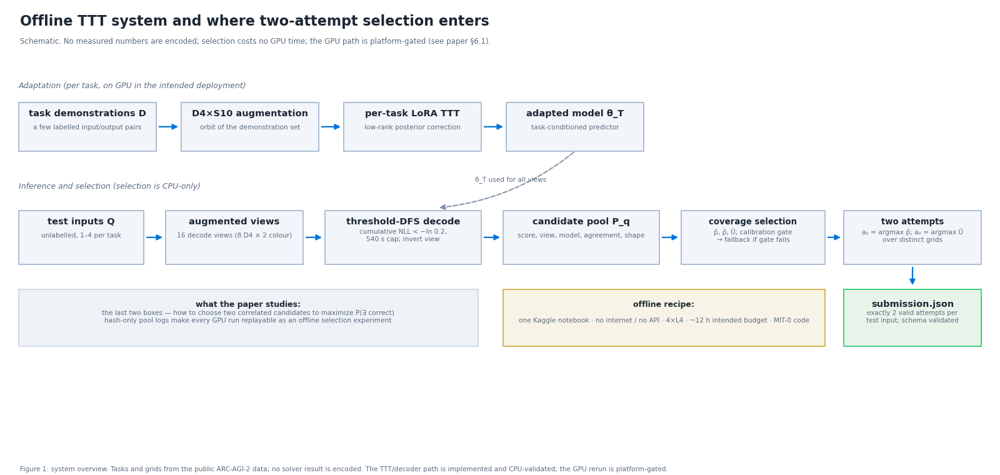
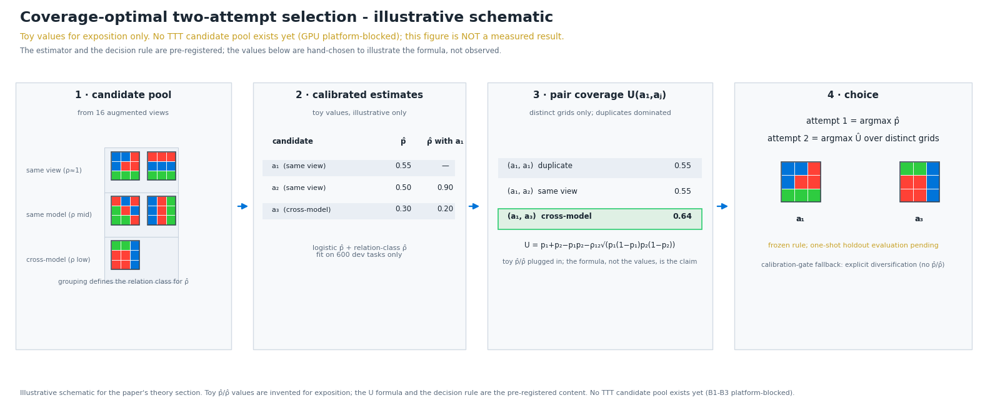
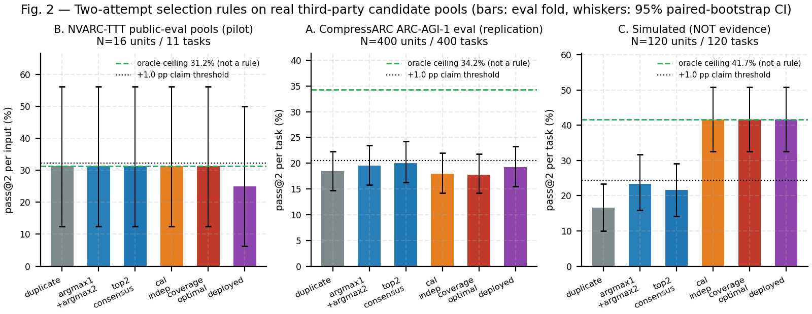
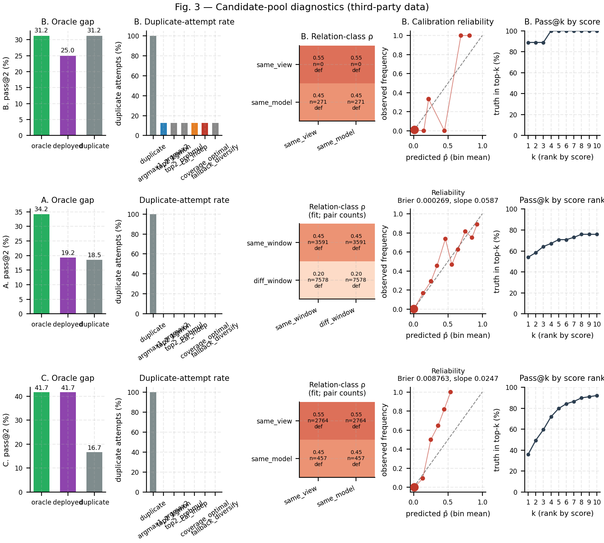
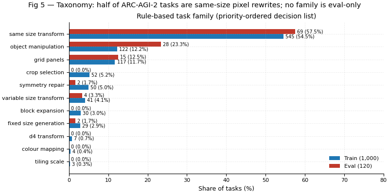
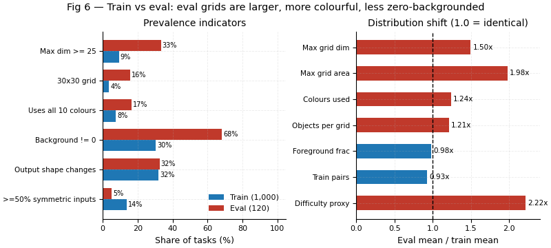
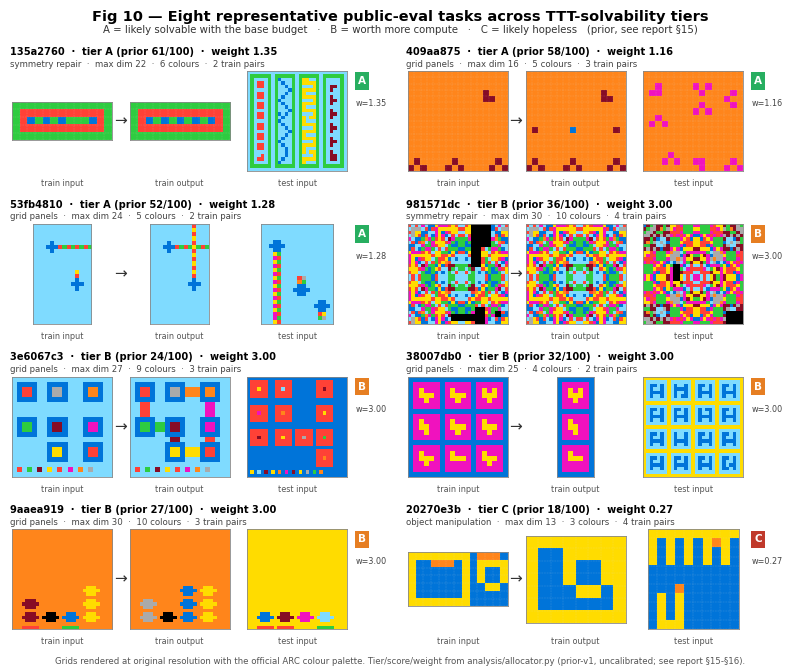
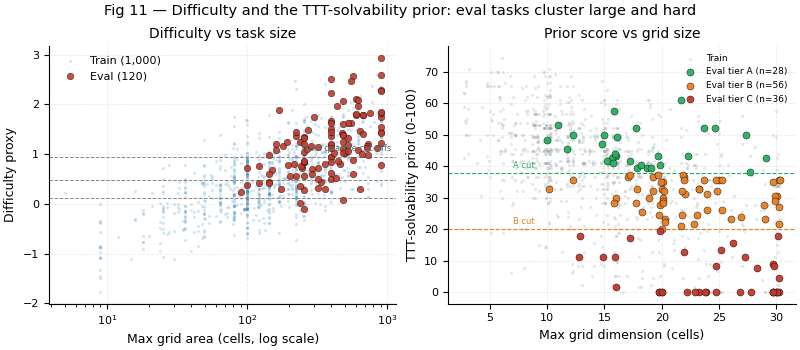

# Two Guesses, One Score: Coverage-Optimal Selection and Its Empirical Limits in ARC-AGI-2 Solver Pools

*Theory, a pre-registered benchmark on real solver candidate pools, and a measured negative result*

**Final draft v2 — 2026-10-18.** Table 2 is filled from the frozen benchmark artifact (`analysis/results/selection_benchmark.json`, command `python analysis/selection_benchmark.py`); every number in the body is measured or explicitly marked not measured, and the full claim-to-artifact mapping is in `paper/evidence_table.md` and Appendix B. **No priority claim.**

---

## Abstract

ARC-AGI-2 gives each test input exactly two attempts, scored by exact match, so choosing the two answers is a first-class decision problem. We formalize it as coverage optimization — maximize U(a1,a2)=1−P(¬C(a1)∧¬C(a2)) — and prove three results: under independent correctness the optimal pair is the two largest calibrated probabilities; submitting the same grid twice is strictly dominated; and argmax-once is provably suboptimal when candidates share error modes. The theory is sound and the simulated benchmark is strongly positive (coverage 41.67% vs 16.67% duplicate and 23.33% argmax; +18.34 pp over argmax, 95% CI [11.7, 25.0]), but on real public pools the solver's own score ordering already saturates recoverable two-attempt coverage. On 400 CompressARC tasks the solver's top-2 covers 20.00% and our coverage-optimal rule 17.75% — below the top-2, below argmax+argmax (19.50%), level with duplicate (18.50%) — against 34.25% oracle coverage: 14.25 points of headroom that is not re-ranking-reachable (candidate AUC 0.981, score-dominated). On a small ARC-AGI-2 pilot (16 holdout inputs) every rule matches the 31.25% oracle ceiling while the deployed fallback loses one input. Two attempts are not two chances unless the pool carries genuinely independent evidence; the bottleneck is candidate generation/coverage, not selection. We also report a CPU-validated TTT system, a data characterization and leakage audit, and a platform-gated account. No end-to-end solver score or leaderboard claim is made.

---

## 1. Introduction

ARC-AGI-2 measures skill-acquisition efficiency on unseen grid transformations rather than stored skill [1, 2]. Its Kaggle incarnation is efficiency-constrained [12]: the submitted notebook is re-run offline for ~12 hours with no internet, and each test input receives exactly two guesses. Because the metric rewards exact matches — a task counts as solved when every test input is covered by either attempt — **selection** is a first-class decision problem, separate from generation: a solver with the correct grid somewhere in its pool still scores zero if its two attempts miss it.

Public practice handles selection with aggregation heuristics. TTT solvers adapt a small pretrained model per task, decode many candidates from augmented views, and rank by inverse consensus or a likelihood variant [3, 4, 8, 9]; the submission takes the top two distinct grids by that score. We re-derive selection from the scoring rule. Three observations drive the paper. First, what matters is P(either guess correct), not P(first guess correct); two ambitious correlated guesses can be worse than one plus a hedge. Second, correlation is structural: candidates share TTT state, augmentation view, beam prefix and model, and identical grids are perfectly redundant, so consensus scores calibrated under independence are overconfident about the joint event. Third, the better rule has a price: it needs calibrated probabilities and correlations and must refuse to deploy when they cannot be estimated.

This paper contributes a formalization, a pre-registered test, and an honest measured answer. (i) We define the coverage objective, prove three results, and give an exact Bernoulli-correlation pair formula and calibrated plug-in estimator (§3). (ii) We freeze a claim/downgrade protocol and build a benchmark on real third-party pools at two scales plus simulated stress tests (§4). (iii) The measured result is a bounded negative one, and the verdict is `DOWNGRADE_TO_ANALYSIS`: the simulation is strongly positive (coverage 41.67% vs 16.67% duplicate, +18.34 pp over argmax with 95% CI [11.7, 25.0]), but on 400 real CompressARC tasks the solver's top-2 covers 20.00% while the coverage-optimal rule covers 17.75%, below the duplicate baseline, against 34.25% oracle coverage — 14.25 points of headroom that is not re-ranking-reachable. The small ARC-AGI-2 pilot shows every rule at the 31.25% oracle ceiling. Selection is not the bottleneck; candidate coverage/generation is (§4.3–4.4). (iv) We add a data characterization and leakage audit (§5), a CPU-validated open-source TTT system with a platform-gated access report (§6), and a landscape analysis of nine public notebooks (§7).

Nearest prior work: public-notebook heuristics use "coverage-aware set selection" and structural attempt-2 distinctness [23]; coverage-oriented correlated subset selection is formalized for model routing [24]; single-answer selection under an imperfect verifier has an extreme-value theory [25]. We give a formal treatment of two-attempt ARC submission as coverage-optimal selection over distinct candidates, using calibrated correctness probabilities and error correlation, plus a score-sufficiency criterion for when reranking cannot realize a pool's oracle headroom. The objective is classical; what we add is this instantiation, estimator and criterion.



**Figure 1.** Offline TTT system and where selection enters: demonstrations → augmented TTT → threshold-DFS decoding → candidate pool with scores and view provenance → calibrated coverage selection → two-attempt submission. Selection costs no GPU time. Schematic; no measured numbers encoded.

---

## 2. Problem formalization and notation

**Task and submission.** A task is T=(D,Q) with labelled demonstrations D and unlabelled test inputs Q=(q_1,…,q_m); grids are integer arrays over colours 0–9, at most 30×30. For each test input the submission provides an ordered pair of distinct grids (a_1,a_2); C(a)∈{0,1} is the latent event that a is exactly required. The primary sources use two metric definitions — per-test-input coverage and task-level all-or-nothing — both monotone in per-input coverage P(C(a_1)∨C(a_2)); the per-input score averages it, the task-level score is its m-fold product [3, 21]. The objective below is therefore valid under either reading.

**Coverage objective.** For attempts a_1,a_2,

 U(a_1,a_2):= 1 − P(¬C(a_1) ∧ ¬C(a_2)). (1)

Maximizing U differs from maximizing P(C(a_1)): the joint failure term couples the attempts.

**Candidate pools from TTT.** TTT adapts a pretrained ARC-SFT model θ on augmented demonstrations and decodes under transformed views; for view v (augmentation g_v, beam path, model member) the predicted grid is inverted as ŷ_v=g_v^{-1}(f_θ(g_v·q)). The pool for test input q is

 P_q = {(y_i, s_i, view_i, model_i, agree_i, shape_i)}, (2)

with s_i a plausibility score, agree_i the view count for the same grid, and shape_i a demonstration-derived shape flag. Every candidate is a hypothesis about the same output. The pool's oracle ceiling upper-bounds any rule's per-input accuracy and is reported alongside the rules.

**Relation classes.** Pairs are grouped by shared failure factors: `same_grid` (correlation 1, never worth two attempts), `same_view` (same TTT state/augmentation), `same_model` (different views of one model), `same_model` (different views of a model), `cross_model`/`cross_source` (lowest correlation). The rule needs only per-class error correlations, observable in metadata and never using labels.

**Provenance classes.** No GPU run of ours exists, so empirical sections separate CPU-only measurements, measurements computed from third-party released candidate logs (we run no model), synthetic pools, and dated context. A third-party dump measures how well *their* pool supports selection, not how well our pipeline performs.

**Table 1. Evaluation datasets (frozen).**

| id | source | benchmark | scale / unit | published anchor | role |
|---|---|---|---|---|---|
| B | `vanductan/arc-agi-2-candidate-dump` (displayed LB 30.97) | ARC-AGI-2 public eval | 20 tasks / 29 test inputs; unit = input; 347 candidate files | oracle-any-2 9/29 = 31.0%; source top-2 8/29 = 27.6% | primary, **pilot** (CIs mandatory) |
| A | CompressARC [6] bundled histories (Liao & Gu 2025; MIT) | ARC-AGI-1 train/eval | 400 eval tasks (fit 400 train); unit = task; hash-level | pass@2 80/400 = 20.00%; any-guess 137/400 = 34.25% | secondary, large-N replication |
| C | Parameterised simulated pools | synthetic | many seeds; known ground truth | oracle by construction | theory stress test + estimator sanity |

---

## 3. Theory

### 3.1 Independent case: top two calibrated probabilities

If correctness indicators are independent with p_i=P(C_i), then P(¬C_i∧¬C_j)=(1−p_i)(1−p_j), so

 U(i,j) = p_i + p_j − p_i p_j, (3)

strictly increasing in each argument. The coverage-optimal pair is therefore the two largest p_i, and attempt order is irrelevant. This is the only regime in which first-guess ranking is coverage-optimal — the assumed regime behind inverse-consensus top-2 when views are treated as independent.

### 3.2 Duplicates are strictly dominated

If a_2 is the same grid as a_1, C(a_2)=C(a_1) and U(a_1,a_2)=P(C(a_1))=p_{a_1}; any distinct candidate with p>0 strictly increases coverage. **Proposition 1.** Submitting the same grid twice is strictly dominated by any distinct candidate with positive correctness probability. The empirical consequence is a free diagnostic: duplicate rate × P(first guess correct) quantifies the waste.

### 3.3 Correlation breaks argmax-once

Candidates share TTT state, augmentation view, beam prefix, and model. For two Bernoulli correctness indicators with correlation coefficient ρ,

 U(i,j) = p_i + p_j − p_i p_j − ρ√(p_i(1−p_i)p_j(1−p_j)), (4)

from P(¬C_i∧¬C_j)=(1−p_i)(1−p_j)+Cov(C_i,C_j). Two same-view candidates with perfectly correlated failures (ρ=1) force equal marginals p_i=p_j=p: their pair coverage is U=p, since the second attempt adds nothing on failure. An independent third candidate with p_3>0 gives U=p+p_3−p p_3>p; at p=0.50, p_3=0.35 the gain is +17.5 coverage points on that input. **Theorem 1.** Under positive error correlation, the pair maximizing the first guess is not in general coverage-optimal; a decorrelated candidate can strictly improve coverage. For ρ<1 the pairwise preference condition between the runner-up j and a decorrelated candidate k is

 (1−p_1)(p_k−p_j) > ρ_{1k}√(p_1(1−p_1)p_k(1−p_k)) − ρ_{1j}√(p_1(1−p_1)p_j(1−p_j)). (5)

Diversification pays exactly when the correlation penalty exceeds the probability advantage — the typical regime for per-view errors. If the pool shows zero or negative correlation the theorem does not force diversification, which is why ρ̂ is measured rather than assumed.

**Corollary.** If the ranking score is cluster mass and views are independent, top-2 by mass coincides with top-2 by posterior probability, so the coverage rule reduces to inverse consensus. The formulation is a strict generalization: public heuristic under independence, different behaviour under correlation.

### 3.4 Calibrated plug-in estimator

Neither p_i nor ρ_ij is observable at submission time, so we estimate them in a frozen pipeline. (i) **p̂**: logistic regression [10] on frozen within-input features (score rank/z, log agreement, cluster mass, top-cluster, shape, model count), fit on a dev split only. (ii) **ρ̂**: per relation class from the dev co-failure statistic, clipped to [−0.95,0.99], with frozen pooling and a conservative default for classes with <30 pairs. (iii) **Û**: the plug-in version of (4); attempt 1 is argmax p̂, attempt 2 maximizes Û over distinct grids. (iv) **Gate and fallback**: deploy only if dev cross-fit calibration has Brier ≤0.10, reliability slope in [0.7,1.3] and at least one estimable relation class; otherwise deploy a no-calibration fallback (highest agreement, then a different grid and view). The claim is pre-registered: coverage must exceed published top-2 by ≥+1.0 point with 80% paired-bootstrap CI lower bound >0 (2,000 resamples over tasks, seed 0), else negative/analysis [22].



**Figure 4.** Illustrative schematic of the coverage rule: candidate pool grouped by relation class, calibrated p̂/ρ̂, pair coverage U, and the chosen distinct pair. Toy values only — not measured.

### 3.5 TTT as amortized Bayesian adaptation

Why are TTT pools plausible? Read ARC-SFT training as approximate posterior inference [13]: the parameters represent a prior over task rules, and per-task TTT performs amortized Bayesian adaptation. With a Gaussian prior around the SFT optimum, a LoRA update θ_T=θ_SFT+BA is a low-rank posterior correction, and a PAC-Bayes sketch bounds expected per-task error by the prior's error plus √((KL(q_T‖p)+ln(2n_eff/δ))/2n_eff), with KL≈‖BA‖²/2σ², implying an interior optimum in LoRA rank/steps and larger gains where the SFT prior is weakest. Test-time augmentation is an equivariance prior, valid only where the task rule commutes with the transform; we log a frozen consistency proxy κ_T and pre-register that augmentation helps only when κ_T is high. It is a sketch, not a bound; it explains why pools concentrate near the truth and why errors correlate — the structure selection exploits.

---

## 4. Main empirical study: selection rules on real candidate pools

### 4.1 Sources, reproduction gates, and protocol

No GPU run of ours exists (§6), so the study uses released third-party candidate logs. The rule operates on a pool regardless of who generated it, but the claim changes: gains are **pool-conditioned**, bounded by oracle coverage, and statements about released pools, not decoder accuracy. Sources are frozen before evaluation; a source whose gate fails is excluded.

**Table 3. Reproduction gates (source-published metric vs our re-derivation).**

| source | gate | published | our reproduction | pass |
|---|---|---|---|---|
| B | coverage summary | 29 inputs; oracle 9/29; top-2 8/29 | exact, 0 per-input mismatches | yes |
| A | upstream script, 2000 steps | solved 137/400; ≤2 guesses 80/400 | exact via bundled artifact | yes |

The gates ensure rule comparisons use files we decode as their producer did. For A, candidates are hash-level solution histories; no grids are redistributed and the unit is the task, matching the source metric. Rules are evaluated in fixed order: duplicate, argmax1_argmax2, top2_consensus, cal_indep, coverage_optimal, oracle_any2 (ceiling), and a deployed rule selected on the fit split. Splits are over tasks: B uses a task-hash dev/holdout split (9/11 tasks; 13/16 inputs); A uses the source train→evaluation split (400/400). Statistics are paired bootstrap over tasks (2,000 resamples, seed 0) [14] with 80%/95% CIs plus calibration diagnostics. No refits or rule changes after the holdout is read.

### 4.2 Pilot evidence on Dataset B

B is the only public candidate-dump notebook we could find, so its scale is fixed at 20 tasks and the protocol labels it pilot-only; its task-level holdout split yields 16 test inputs over 11 tasks. On those inputs the oracle ceiling is 31.25% (5/16) and every deployable rule — duplicate, argmax+argmax, top-2 consensus, calibrated-independent and coverage-optimal — also covers 31.25%: the rules match the ceiling exactly and are indistinguishable from each other (80% CI [18.75, 43.75]), so measured headroom is 0 on this fold. The deployed no-calibration fallback covers 25.00%, one input below. A full 29-input pass gives the same picture (oracle 31.0%, top-2 27.6%). No selection effect is measurable at this N; B is not claim-bearing.

### 4.3 The large replication and the simulated stress test

A is the only claim-bearing test because a +1.0-point effect is visible there: the solver's top-2 covers 80/400 tasks (20.00%) while any-guess coverage is 137/400 (34.25%), a headroom of 57 tasks = +14.25 task-level points, and its histories are complete over 2,000 steps. The measured result is a null. Candidate correctness is predictable (AUC 0.981) but dominated by the source score, so calibrated re-ranking does not beat the solver's own ordering: the coverage-optimal rule lands at 17.75% (below top-2 20.00%, argmax+argmax 19.50% and duplicate 18.50%), and cal_indep at 18.00% also sits below top-2. The missed truths are not near the top of the pool either — their score-rank median is 12 and only 24 of 57 are in the top 10 — which is why no re-ranking of the exposed metadata recovers them. The pre-registered margin is not met (`DOWNGRADE_TO_ANALYSIS`); the gate also failed, so the deployed rule is the no-calibration fallback (19.25%). The 14.25-point oracle headroom is real but not re-ranking-reachable. CompressARC [6] is ARC-AGI-1-era, 376/400 of its evaluation ids also appear in the ARC-AGI-2 training corpus, and candidates are hash-level with no grid geometry — caveats that bound, but do not explain away, the null.

C isolates the estimator under known ground truth; simulated pools parameterise duplicates, correlation, calibration strength and pool size, and C is a sanity check, not evidence about real solvers. The simulation is strongly positive: oracle 41.67%, duplicate 16.67%, argmax+argmax 23.33%, top-2 21.67%, and both calibrated rules 41.67% — a +18.34-point gain over argmax (95% CI [11.7, 25.0]), comfortably past the pre-registered margin. The gate's reliability-slope check still fails (slope 0.025), but with a simulated consensus signal the deployed fallback now coincides with the calibrated rules at 41.67%. C shows the rule mechanics can work in principle when the pool's generative assumptions hold; it is not evidence about real solver pools.

**Table 2. Frozen two-attempt rules on the three datasets (pass@2, %; 80% bootstrap CI in brackets; seed 0, 2,000 resamples; values to two decimals).**

| rule | B: ARC-AGI-2 TTT pools (16 inputs / 11 tasks) | A: CompressARC (400 tasks) | C: simulated (120 tasks) |
|---|---|---|---|
| oracle_any2 (ceiling, not a rule) | 31.25 [18.75, 43.75] | 34.25 [31.25, 37.50] | 41.67 [35.83, 47.50] |
| duplicate | 31.25 [18.75, 43.75] | 18.50 [16.00, 21.00] | 16.67 [12.50, 20.83] |
| argmax1_argmax2 | 31.25 [18.75, 43.75] | 19.50 [17.00, 22.00] | 23.33 [18.33, 28.33] |
| top2_consensus | 31.25 [18.75, 43.75] | 20.00 [17.50, 22.75] | 21.67 [16.67, 26.67] |
| cal_indep | 31.25 [18.75, 43.75] | 18.00 [15.50, 20.75] | 41.67 [35.83, 47.50] |
| coverage_optimal | 31.25 [18.75, 43.75] | 17.75 [15.25, 20.25] | 41.67 [35.83, 47.50] |
| deployed (gate-selected) | 25.00 [12.50, 37.50] | 19.25 [16.75, 21.75] | 41.67 [35.83, 47.50] |

All cells are pass@2 from the frozen artifact `analysis/results/selection_benchmark.json` (sha256 `6c16abfef7f0efe3a1a6bbe9f6251c9aeef1893ee7b0f44fdfdb9c2eb34ab71a`), regenerated into `analysis/results/SELECTION_RESULTS.md` (same hash) by `python analysis/selection_benchmark.py`; brackets are 80% CIs; rule order and pre-registered thresholds are unchanged. C is simulated and is not evidence about real solvers.


The results support one interpretation: **the solver's own score ordering already saturates the recoverable two-attempt coverage, so selection is not the bottleneck — candidate coverage/generation is.** In A, the second attempt converts 18.50% → 20.00% for the solver's own ordering, and calibrated re-ranking never exceeds 20.00%: the 14.25-point oracle headroom is real, but the extra oracle candidates are not separable from the metadata the pool exposes. In B the effect is unresolvable; in C the ordering is right and the effect is large (+18.34 pp, 95% CI [11.7, 25.0]) but C is simulated. Two attempts are not two chances unless the pool contains genuinely independent evidence. The pre-registered rule resolves the claim: A's margin is negative (17.75% vs 19.50%, margin −1.75 pp), so the verdict is **`DOWNGRADE_TO_ANALYSIS`** and the deployed rule is the no-calibration fallback (19.25%). It says nothing about other decoders, ensembles, or the full TTT pipeline with a GPU. It would be falsified by (F1) a calibrated rule beating the solver's ranking by ≥+1.0 point with 80% CI lower bound >0 on a claim-bearing pool; (F2) metadata beyond the source score exposing oracle-gap candidates; (F3) a multi-decoder union whose second-attempt marginal coverage exceeds the noise band. The formalization is right; the empirical reach is limited.



**Figure 2.** Rule comparison with bootstrapped CIs: pass@2 and paired Δ vs the published baseline, per dataset (B pilot; A replication; C simulated). Oracle coverage is a ceiling, not a rule; bars are the pre-registered 80%/95% intervals; the +1.0-point line applies to the claim-bearing dataset only.



**Figure 3.** Pool diagnostics: oracle gap, duplicate rates, relation-class ρ heatmap with pair counts, calibration reliability for B/A and C.

---

## 5. Data characterization and leakage audit

Selection theory is only as good as its benchmark, so we characterize the public ARC-AGI-2 data [20] first: 1,000 training tasks (3,232 pairs, 1,076 test inputs) and 120 evaluation tasks (359 pairs, 167 inputs). A SHA-256 audit finds zero shared tasks, zero shared (input,output) pairs and zero shared input grids between public training and evaluation; the only overlaps are eight input grids reused across different training tasks and one test input equal to a training output in its own task, neither enabling memorization. 

It is also not a pattern-matching test: eight single-rule heuristics solve 1.6% of training, 1.5% of holdout and 0% of the 120 public-evaluation tasks. Evaluation is harder on every structural axis — mean maximum grid dimension 21.95 vs 14.67 (p<0.001), 64% of evaluation tasks in the hardest heuristic-proxy quartile — and a rule-based taxonomy assigns 54.5% of training and 57.5% of evaluation tasks to same-size local rewrites, then object manipulation (12.2%/23.3%) and grid panels (11.7%/12.5%).

A transparent solvability prior splits the 120 evaluation tasks into 28 likely-solvable, 56 worth-extra-compute and 36 likely-hopeless tasks and would spend 76% of a fixed TTT budget on the middle tier. It is uncalibrated, a scheduling hypothesis rather than a solve rate; no solver-performance number here comes from it.

**Table 6. Data-characterization summary (public ARC-AGI-2; unless noted).**

| quantity | value | artifact |
|---|---|---|
| train / eval tasks | 1,000 / 120 | §1 |
| shared tasks / pairs / input grids | 0 / 0 / 0 | §12 |
| trivial-heuristic solve: train / holdout / eval | 1.6% / 1.5% / 0% | §13 |
| max grid dimension: train vs eval | 14.67 vs 21.95 (p<0.001) | §11 |
| solvability tiers A/B/C | 28 / 56 / 36 (uncalibrated) | §15 |



**Figure 5a.** Rule-based task-family distribution for 1,000 training and 120 public-evaluation tasks (analysis/report.md §9). Same-size pixel rewriting dominates both; no family is evaluation-only.



**Figure 5b.** Train-vs-evaluation shift: prevalence indicators (left) and eval/train mean ratios (right) for size, palette, demonstrations, and background (analysis/report.md §11).



**Figure 6a.** Eight representative public-evaluation tasks across prior tiers with budget weights (analysis/report.md §15). Tier assignment is an uncalibrated prior, not a solve rate.



**Figure 6b.** Difficulty proxy and the uncalibrated TTT-solvability prior versus task size (analysis/report.md §15–16).

---

## 6. An open-source offline TTT system and reproducibility report

The repository is a complete, self-contained implementation of the offline Kaggle pipeline: task loader and submission validator, D4×S10 augmentation group, threshold-DFS decoding, NLL rescoring, inverse-consensus aggregation, the coverage rules of §3, per-task TTT, four-worker orchestration with resume and wall-clock guards, and hash-only pool logs. It imports without torch; heavy dependencies live only inside the TTT engine; offline dependencies come from a kernel-source mount, and the competition path needs no internet or external API. The repository is released under **MIT-0** (SPDX `MIT-0`, no attribution requirement, ARC-Prize-compatible); third-party components retain their verified licences: ARC-AGI-2 data Apache-2.0; the `sorokin/qwen3_4b_grids15_sft139` model and Qwen3 base Apache-2.0; CompressARC and `arc-dsl` MIT; Unsloth/transformers/peft Apache-2.0. The public notebooks we discuss declare no licence: under the Kaggle Terms they are prior art to cite, not code to vendor, so lineage methods are clean-room re-implemented and cited by URL; no notebook code enters the repository, and a NOTICE records the attributions. The `LICENSE` file still holds standard MIT text and must be replaced with SPDX `MIT-0` before public release — a repo-side action this paper does not rely on.

Validation is extensive relative to execution: 154 passing CPU tests (~10 s); a schema-valid CPU fallback packet over all 120 public-evaluation tasks/167 inputs in 8.3 s on Kaggle; end-to-end TTT-path validation with a tiny Qwen model and the real tokenizer (dialect guard, LoRA, 2 steps, 8-view decode, selection, schema), catching two real bugs (grad-requiring logits; silent token remapping); and a CompressARC harness that re-derives the bundled predictions and exports hash-level pools for A.

**The GPU path is unmeasured, and this is stated rather than papered over.** The system was designed for a 4×L4, ~12 h offline rerun, but every execution attempt was platform-gated (§6.1). No TTT pool of ours exists, no hidden-test access occurred, no leaderboard score of ours is reported, and no number here was produced by a GPU. The selection study therefore uses third-party pools (§4), and the pipeline is presented as validated-by-construction, not validated-by-run.

### 6.1 Platform-gated access: a factual report

Kaggle [15] requires phone verification before Joining the competition; the project's account did not have it. Every kernel request for an `NvidiaL4`/`NvidiaTeslaT4` machine ran CPU-only: `torch.cuda.is_available()` returned false, `device_count` was zero, no `nvidia-smi` existed, and competition attachment was rejected pending rules acceptance. Six probes and thirteen recorded runs consumed CPU only and **zero Kaggle GPU-hours**. The owner submitted a support ticket; all uploads were frozen pending official feedback; the packets were built, hashed, dry-run verified on CPU and stored in a frozen handoff bundle with checksums and a resume procedure. No GPU run exists, no estimated leaderboard number is reported, and no hidden-test data was accessed.

**Table 5. System and reproducibility matrix.**

| component | validation evidence | status |
|---|---|---|
| CPU test suite | 154 tests pass (~10 s) | |
| CPU fallback submission | 120 tasks/167 inputs, schema-valid, 8.3 s | |
| TTT path (tiny model) | tokenizer guard, LoRA, decode, selection, schema OK | |
| Kaggle packet smoke runs | imports/mounts/tokenizer verified; graceful TTT→fallback | |
| CompressARC reproduction | 137/400 solved; 80/400 pass@2 | |
| Frozen handoff bundle | checksums, resume procedure, no uploads | |
| GPU end-to-end run | not executed — account gate | |

---

## 7. Public-solver landscape and what transfers

The public ARC-AGI-2 TTT ecosystem is small and homogeneous. In our 2026-10-18 reading of nine public notebooks [16–19], all but one build on the same Qwen3-4B ARC-SFT checkpoint and TTT recipe (per-task LoRA, D4×S10-style augmentation, threshold-DFS decoding, consensus aggregation), with displayed scores clustering at 29.7–31.4. Titles claim 33.89 or 35.9; these appear in titles and author markdown, not as displayed scores, so we quote only the displayed cluster. Methods differ in orchestration: GPU-side log-softmax patches, two-pass pooling with a monotone pass-A invariant, cheap-first ordering, CPU symbolic pre-passes as monotone attempt-2 fillers, and structural attempt-2 diversity — ideas re-implemented, not copied. Complementary families — tiny recursively-refined per-task networks (TRM [5]), evolutionary program synthesis (SOAR [7]) and deep-ensemble uncertainty [11] — are not evaluated here.

The landscape has a second lesson, and it is why the study uses released candidate pools rather than saved submissions. The saved public-notebook artifacts we could obtain and score against public-evaluation labels are partial or truncated reruns: correct-input counts over the full evaluation set (missing task coverage counted wrong) are vanductan 8 (4.65% of inputs), mayankraaz 4 (2.33%), and woominyo / anthonyxlyu / rabari9999 3 each (1.74%) — a **1.7–4.7%** range, far below their displayed 29.7–31.4 public-LB scores (`analysis/results/saved_artifact_scores.json`). This gap is not fraud; it reflects the difference between a full 12-hour rerun on hidden test data and an incomplete saved artifact. Saved submissions are therefore weak evidence; a released candidate-pool dump can be validated against its source's coverage summary — exactly what §4.1 does.

**Table 4. Public-solver landscape (dated reading 2026-10-18; displayed scores are secondary-source context).**

| notebook (family) | displayed | claimed | mechanism | transferable element |
|---|---|---|---|---|
| mayankraaz | 31.39 | 35.97 | triple-pass pooled TTT, controller, LOO-DSL | cheap-first ordering; pass-A invariant |
| yuvrajlamba01 | 31.39 | 54.31% | TTT + deterministic symbolic solver | monotone symbolic filler |
| rabari9999 | 30.97 | n/a | v38 perf patch clone | GPU-side log-softmax patch |
| vanductan | 30.97 | n/a | perf-patched research dump | candidate-pool logging (Dataset B) |
| mikelou1 / anthonyxlyu | 30.14 | 33.89 | v38 minimal perf patch | algebraically identical speed patch |
| woominyo | 29.72 | n/a | perf patch + interleaved ensemble | attempt ordering via interleaving |
| dmitriigluzdov | 29.17 | n/a | +6 transformer layers | negative result — capacity expansion |
| delongyang | 15.69 | n/a | 27B FP8 zero-shot | model-size/throughput trade-off |
| cprs | 30.56 | 80%+ target | TTT + LLM program-synthesis pre-pass | verified-program candidate source |

---

## 8. Limitations, ethics, and reproducibility

The largest limitation is structural: this paper reports **no end-to-end solver result of our own**, because the platform gate prevented every GPU run. The empirical core is a selection study on third-party pools; its claims are narrow — pool-conditioned gains bounded by the oracle ceiling, never leaderboard claims. Dataset B is tiny (29 inputs, 20 tasks) and pilot-only; on its 16-input eval fold the measured headroom is zero, so no positive claim is certifiable there even in principle. Dataset A is large but a different generation and representation (hash-level candidates, task-level unit), and nearly all its evaluation tasks overlap the ARC-AGI-2 training corpus, so it cannot support an OOD claim. Dataset C is synthetic and validates only the estimator and implementation.

The theory is equally bounded. Coverage identities are exact for Bernoulli correctness with the stated correlations, but p̂ and ρ̂ are estimates whose errors flow into the decision; the calibration gate is a guard, not a guarantee. The TTT discussion is a PAC-Bayes sketch, not a distribution-free bound; κ_T is a proxy. Selection cannot repair a decoder: if truth is absent or the pool is a downstream-selected dump that omitted it, no rule recovers it. Sources were selected after an informal survey of public notebooks — an availability bias.

All data are public (ARC Prize data, public notebook outputs, CompressARC artifacts); no personal data, credentials, or hidden-test information is used. Third-party artifacts are used as data with attribution; no third-party code was copied, and licences of re-implemented ideas are documented where known. The platform-gated record is included because a silent GPU failure would otherwise be indistinguishable from a weak result; reporting it is a reproducibility obligation. Reproducibility depends on the frozen artifacts in Appendix B and on the repository reaching a single consistent licence before public release.

---

## 9. Conclusion

Two attempts per test input make answer selection a genuine decision problem, and coverage is the right formalization: under independent correctness the familiar top-2 rule is already optimal, and under correlated errors a calibrated pair rule is provably better. The measured answer, however, is a bounded negative result: the theory is sound and the simulation strongly positive, but on real public solver pools the solver's own score ordering saturates recoverable two-attempt coverage. On 400 CompressARC tasks the solver's top-2 covers 20.00% while the coverage-optimal rule covers 17.75%, below duplicate, against 34.25% oracle coverage — 14.25 points of headroom the exposed metadata cannot reach. The verdict is `DOWNGRADE_TO_ANALYSIS`; selection is not the bottleneck, candidate generation/coverage is. The transferable artifacts are the formalization, the pre-registered protocol and benchmark, the data characterization and leakage audit, the open-source implementation, and a documented platform-gated record — plus a falsification target: a pool with genuinely independent evidence, or features that expose the oracle candidates the source score hides.

---

## References

1. Chollet, F. *On the Measure of Intelligence.* arXiv:1911.01547, 2019. https://arxiv.org/abs/1911.01547
2. ARC Prize. *ARC Prize 2026 competition and paper-track rules.* https://arcprize.org/competitions/2026 (accessed 2026-10-18).
3. Sorokin, I., Puget, J.-F. *NVARC solution to ARC-AGI-2 2025* (Kaggle 1st place; model `sorokin/qwen3_4b_grids15_sft139`, Apache-2.0), 2025. https://www.kaggle.com/models/sorokin/qwen3_4b_grids15_sft139 ; https://github.com/1ytic/NVARC
4. Koushik Rudra. *failed-in-aimo* public Kaggle notebook (NVARC-style TTT reference), 2026. https://www.kaggle.com/code/koushikrudra/failed-in-aimo
5. Jolicoeur-Martineau, A. *Less is More: Recursive Reasoning with Tiny Networks (TRM).* arXiv:2510.04871, 2025. https://arxiv.org/abs/2510.04871
6. Liao, I., Gu, A. *ARC-AGI Without Pretraining (CompressARC).* 2025. https://iliao2345.github.io/blog_posts/arc_agi_without_pretraining/ ; code (MIT): https://github.com/iliao2345/CompressARC
7. Pourcel, J., Colas, C., Oudeyer, P.-Y. *Self-Improving Language Models for Evolutionary Program Synthesis: A Case Study on ARC-AGI (SOAR).* arXiv:2507.14172, 2025. https://arxiv.org/abs/2507.14172
8. the ARChitects. *ARC-AGI-2 2025 solution writeup.* 2025. https://lambdalabsml.github.io/ARC2025_Solution_by_the_ARChitects/
9. Cole, J., Osman, M. *Don't throw the baby out with the bathwater: How and why deep learning for ARC.* arXiv:2506.14276, 2025. https://arxiv.org/abs/2506.14276
10. Guo, C., Pleiss, G., Sun, Y., Weinberger, K. *On Calibration of Modern Neural Networks.* ICML 2017. https://arxiv.org/abs/1706.04599
11. Lakshminarayanan, B., Pritzel, A., Blundell, C. *Simple and Scalable Predictive Uncertainty Estimation using Deep Ensembles.* NeurIPS 2017. https://arxiv.org/abs/1612.01474
12. Snell, C., et al. *Scaling LLM Test-Time Compute Optimally can be More Effective than Scaling Model Parameters.* arXiv:2408.03314, 2024. https://arxiv.org/abs/2408.03314
13. Akyürek, E., et al. *The Surprising Effectiveness of Test-Time Training for Abstract Reasoning.* arXiv:2411.07279, 2024. https://arxiv.org/abs/2411.07279
14. Efron, B., Tibshirani, R. *An Introduction to the Bootstrap.* Chapman & Hall, 1993. DOI: 10.1201/9780429246593
15. Kaggle. *ARC Prize 2026 ARC-AGI-2 code-competition metadata* (kernels-only, no-internet rerun). https://www.kaggle.com/competitions/arc-prize-2026-arc-agi-2 (accessed 2026-10-18).
16. vanductan. *arc-agi-2-candidate-dump* public Kaggle notebook (displayed LB 30.97; candidate-pool research dump), 2026. https://www.kaggle.com/code/vanductan/arc-agi-2-candidate-dump
17. mayankraaz. *arc-agi-2-triple-pass-nvarc-sota-35-9-lb* public Kaggle notebook, 2026. https://www.kaggle.com/code/mayankraaz/arc-agi-2-triple-pass-nvarc-sota-35-9-lb
18. woominyo. *arc26-nvarc-lb33-4xl4* public Kaggle notebook, 2026. https://www.kaggle.com/code/woominyo/arc26-nvarc-lb33-4xl4
19. mikelou1. *arc-agi2-lb33-89-minimal-perfpatch* public Kaggle notebook, 2026. https://www.kaggle.com/code/mikelou1/arc-agi2-lb33-89-minimal-perfpatch
20. ARC Prize. *ARC-AGI-2 public data release* (Apache-2.0). https://github.com/arcprize/ARC-AGI-2 (accessed 2026-10-18).
21. ARC Prize. *ARC-AGI-2 2026 scoring rules and leaderboard snapshot* (secondary rendering, 2026-10-18). https://arcprize.org/competitions/2026/arc-agi-2
22. ARC-2026 team. *Selection protocol v2: pre-registered evaluation on third-party candidate pools* (internal pre-registration, frozen 2026-10-18; released with the paper's artifact bundle).
23. D. Zhong. *arc-agi2-nvarc-plus-ckpt* (v6s) public Kaggle notebook, 2026 (uses "coverage-aware set selection" and a P4 structural-distinctness attempt-2 rule). https://www.kaggle.com/code/dalezhong/arc-agi2-nvarc-plus-ckpt
24. Wei et al. *FlexRouter: Coverage-Oriented Correlated Subset Selection* (COLM 2026). https://arxiv.org/abs/2609.38585
25. Singham. *Selection Under an Imperfect Verifier: An Extreme-Value Theory of Test-Time Compute.* Zenodo DOI 10.5281/zenodo.21976219, 2026. https://doi.org/10.5281/zenodo.21976219

*All web sources accessed 2026-10-18; arXiv identifiers resolve at `arxiv.org/abs/<id>`.*

---

## Appendix A — Pre-registration (condensed from `research/design/selection_protocol_v2.md`)

- **Sources frozen before evaluation:** B = `vanductan/arc-agi-2-candidate-dump` (pilot; 29 inputs/20 tasks — no other public candidate-dump notebook was found); A = CompressARC bundled predictions (claim-bearing; 400 ARC-AGI-1 eval tasks, fit on 400 train; hash-level candidates).
- **Reproduction gates:** B must reproduce 29 units, oracle 9, top-2 8; A must reproduce 137 solved and 80 pass@2 at 2,000 steps. A failed gate excludes the source; it does not trigger rule changes.
- **Units and splits:** B unit = test input, tasks split 9/11 dev/holdout by task hash (13/16 inputs); A unit = task, source-defined split (400/400).
- **Frozen scalar scores:** B = Σ of the eight per-augmentation scores (lower better); A = logaddexp-accumulated pick score (higher better).
- **Rules:** duplicate, argmax1_argmax2, top2_consensus, cal_indep, coverage_optimal, oracle_any2, deployed (selected on fit).
- **Features for p̂ (fixed order):** score rank percentile, score z-score, log(1+agreement), cluster mass, is-top-cluster, shape consistency (B), cross-model count; A adds log first-step and pick-type diversity.
- **ρ classes:** same_candidate (ρ=1, never paired), same_view, same_source, cross_source (pooled only; no cross-source claim).
- **Statistics:** paired bootstrap over tasks, 2,000 resamples, seed 0; 80% and 95% CIs; claim iff Δ ≥ +1.0 point and 80% CI lower > 0 on the claim-bearing holdout.
- **Verdict:** Dataset A does not meet the pre-registered margin — coverage_optimal 17.75% vs argmax1_argmax2 19.50%, margin −1.75 pp (required: ≥+1.0 point with 80% CI lower bound >0) — so the selection claim is `DOWNGRADE_TO_ANALYSIS` and the deployed rule is the no-calibration fallback. Dataset C is simulated and therefore never enters the claim.
- **Deviations:** any change is a new protocol version committed before the affected holdout is read; both versions reported.

## Appendix B — Evidence registry and per-number provenance

All numbers map to rows in `paper/evidence_table.md` (Plan C). Primary artifacts: `analysis/results/selection_benchmark.json` (Table 2 and Fig. 2; command `python analysis/selection_benchmark.py`); `logs/arch-theorist/external_reproduction_gate_arc2_dump.json` (Dataset B reproduction gate); `code/out/compressarc/verify_bundled_eval.json` (Dataset A reproduction gate); `analysis/report.md` (data characterization); `analysis/results/saved_artifact_scores.json` (landscape); `logs/kaggle_freeze.md` and `logs/kaggle_runs.md` (platform gate); `code/docs/RESULTS.md` (CPU baselines and system validation). The theorem and the pre-registration are documented in `research/design/theory.md` and `research/design/selection_protocol_v2.md`, released with the paper bundle. GPU end-to-end execution and our own leaderboard score are **not measured** (platform-gated) and are never cited as results.


## Appendix C — Platform-gated access log (summary)

Thirteen Kaggle runs recorded between 14:00 and 15:06 UTC on 2026-10-18, all CPU-only: six environment/mount/tokenizer probes, two fallback-packet dry runs, two TTT-packet smoke runs, one TTT-probe degradation run. GPU entitlement was requested (`NvidiaL4`, `NvidiaTeslaT4`) and not granted; competition attach was rejected pending rules acceptance, which requires phone verification. Zero Kaggle GPU-hours were consumed; the frozen handoff bundle contains packet checksums and a resume procedure that regenerates packets before pushing. No hidden-test data was accessed and no GPU number appears in the paper.

## Appendix D — Reproduction commands

```bash
# data analysis, split, baselines, allocation, figures (CPU, ~41 s)
bash analysis/run_all.sh

# selection benchmark on third-party pools (CPU; needs the downloaded dumps)
python analysis/selection_benchmark.py

# repository tests and CPU baselines
python -m pytest code/tests -q
python code/compressarc_harness.py verify-bundled --out code/out/compressarc/verify_bundled_eval.json
```

## Appendix E — Exploratory cross-source note

An exploratory check on the partial saved artifacts (task-level 50/70 dev/holdout split, source quality estimated on dev only) found no conversion: on the 70-task holdout the best dev source solves 1/70, best-source attempt-1 plus cross-source attempt-2 also solves 1/70, while the union oracle is 8/70. Cross-source diversification does not convert the observed pool headroom on these partial artifacts. This is an appendix note only; it is not part of the pre-registered study, the artifacts are partial eval-mode runs rather than leaderboard reruns, and source quality was estimated on the dev split only.
